# Rainfall Monitor

An Android client for a personal, hyper-local rainfall monitoring system built for Kerala's rapidly changing microclimate. The app connects to an [ESP32 weather station](https://github.com/grassy345/esp32-mini-weather-station) over **HiveMQ Cloud MQTT**, receives live readings every 10 minutes, and presents rainfall, temperature, pressure, and humidity as live status, graphs, and history.

The system exists because Kerala's weather varies dramatically over small distances and short time windows. A single district-level forecast is often useless when it is pouring in one locality and dry a few kilometres away. This project puts a dedicated sensor station in the garden and streams its measurements straight to a phone.

> **Data flow:** ESP32 weather station → HiveMQ Cloud (MQTT/TLS) → **Rainfall Monitor app** → Room database + live dashboard → optional Telegram alerts.

---

## Table of Contents

- [Features](#features)
- [Companion Firmware](#companion-firmware)
- [Screenshots](#screenshots)
  - [Dashboard](#dashboard)
  - [Data Modes](#data-modes)
  - [Full-Screen Graph](#full-screen-graph)
  - [Full-Screen Table](#full-screen-table)
  - [Gap Representation](#gap-representation)
  - [Notifications](#notifications)
- [Intensity Labels](#intensity-labels)
- [Architecture](#architecture)
- [Tech Stack](#tech-stack)
- [Project Structure](#project-structure)
- [Building](#building)
- [Configuration](#configuration)
- [Permissions](#permissions)
- [Reliability](#reliability)
- [License](#license)

---

## Features

- **Live dashboard** — connection status, current rainfall rate, and colour-coded intensity, all updated in real time.
- **Four data modes** — Rainfall, Temperature, Pressure, and Humidity, switchable with a single tap and shared across every screen.
- **Full-screen graph** — landscape, stepped-line chart with a full-midnight-to-midnight X-axis, per-mode colours, and a tappable tooltip.
- **Full-screen table** — newest-first reading list with intensity-tinted rows and automatic gap separators.
- **Gap detection** — real ESP32 power-cut windows are rendered as `gap: Xh Ym (no data)` rows and greyed chart regions.
- **Date navigation** — step between dates that actually contain data, or jump to any date with a picker.
- **Rain alerts** — high-priority notification the moment rain starts (or resumes after a gap).
- **ESP32 offline watchdog** — alert when no data has arrived for more than 15 minutes.
- **Sensor failure detection** — detects a sensor reporting `null` repeatedly and alerts with an **Acknowledge** action that silences further pings for that episode.
- **Always-on service** — foreground MQTT service with three-layer reconnection, boot auto-start, and a self-healing watchdog.
- **Offline-first** — readings are persisted in Room, so history survives app restarts and airplane mode.

---

## Companion Firmware

This app is the client half of a two-part system. The sensor station itself — a DOIT ESP32 reading a DFRobot tipping-bucket rain gauge, a BMP280, and an SHT30 — lives in the companion firmware repository. It computes the hourly rainfall rate, publishes it to MQTT every 10 minutes, lights status LEDs, and sends Telegram alerts.

> **Firmware repository:** [grassy345/esp32-mini-weather-station](https://github.com/grassy345/esp32-mini-weather-station)

---

## Screenshots

### Dashboard

The dashboard is the first screen shown on launch. It combines a live status card, a preview graph, a preview readings list, and mode controls.

<table>
  <tr>
    <td align="center" width="320">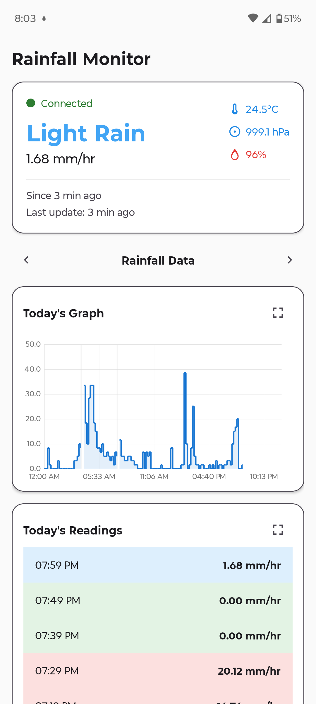</td>
    <td align="center" width="420">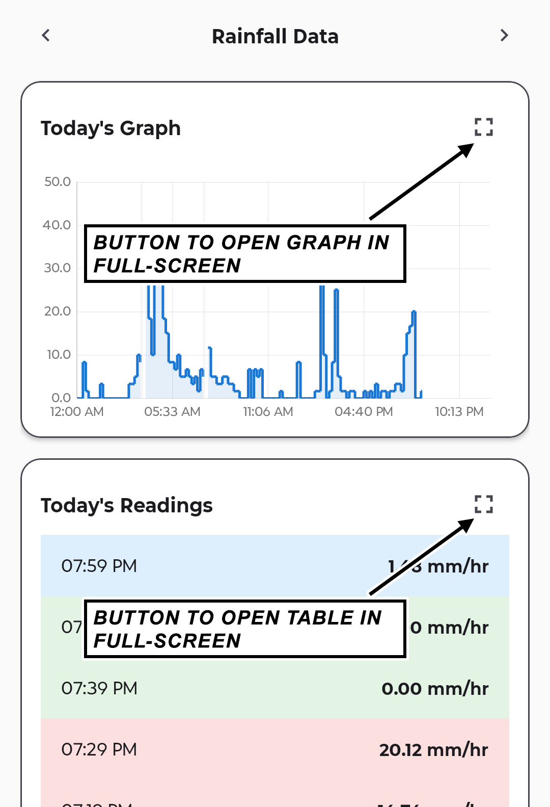</td>
  </tr>
  <tr>
    <td align="center"><em>The dashboard on launch</em></td>
    <td align="center"><em>Full-screen graph and table buttons</em></td>
  </tr>
</table>

The top card shows the current rainfall intensity and hourly rate, how long the current state has lasted ("Since …"), the last-update age, and the live values for temperature, pressure, and humidity. When a reading is older than 15 minutes it is greyed out and marked `(stale)` / `[S]`, indicating the ESP32 may be offline. This state is captured at the start of the [reconnection video](#notifications), where it clears as soon as fresh readings arrive.

### Data Modes

Each of the four sensor modes can be scrolled directly on the dashboard with the previous/next buttons; the same selection carries over into the full-screen graph and table.

<table>
  <tr>
    <td align="center"><video src="https://github.com/user-attachments/assets/bfbfc8db-f4bc-456b-8ec4-c4e0e029dc62" width="240" controls></video></td>
  </tr>
  <tr>
    <td align="center"><em>Scrolling through Rainfall, Temperature, Pressure, and Humidity modes (<a href="assets/videos/main/mode_scroll.mp4">View original source file</a>)</em></td>
  </tr>
</table>

### Full-Screen Graph

The full-screen graph opens in **landscape** and plots a stepped line from midnight to midnight for the selected date.

<table>
  <tr>
    <td align="center">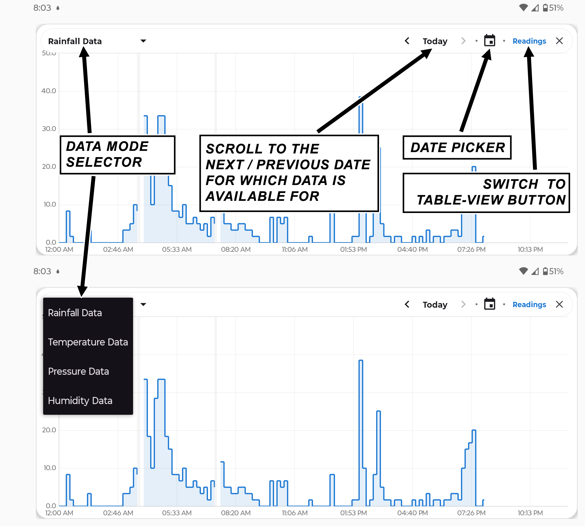</td>
  </tr>
  <tr>
    <td align="center"><em>Graph controls: data-mode selector, previous/next available date, date picker, and switch to Table View</em></td>
  </tr>
</table>

<table>
  <tr>
    <td align="center">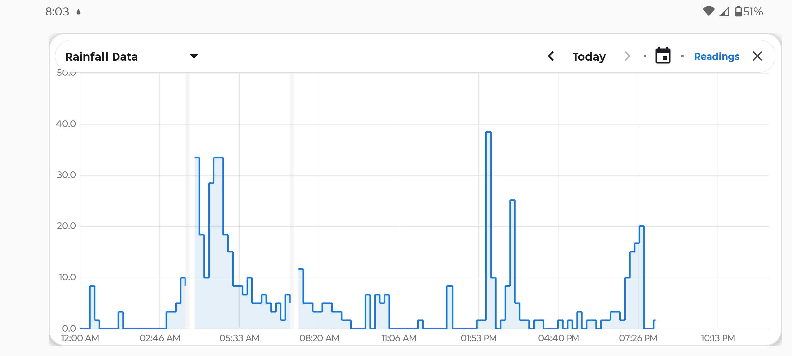</td>
    <td align="center">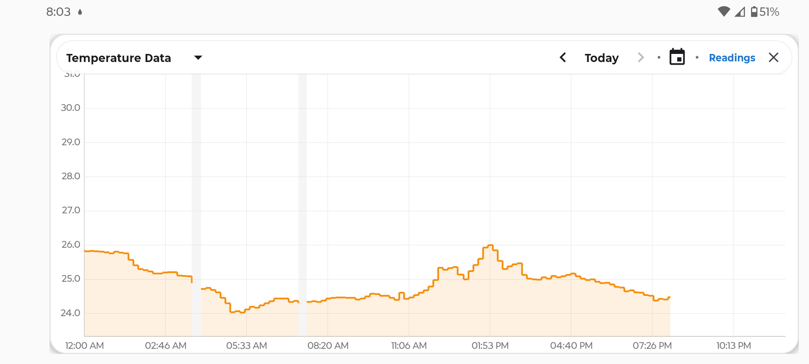</td>
  </tr>
  <tr>
    <td align="center"><em>Rainfall — blue line</em></td>
    <td align="center"><em>Temperature — orange line</em></td>
  </tr>
  <tr>
    <td align="center">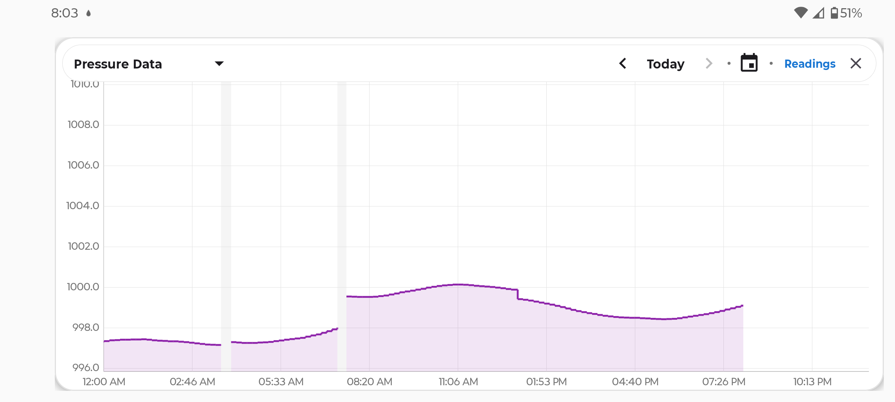</td>
    <td align="center">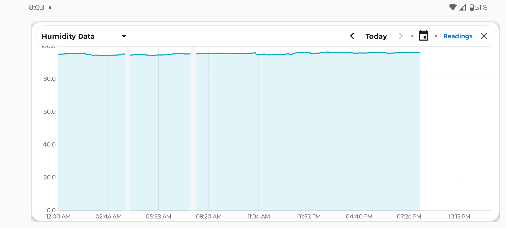</td>
  </tr>
  <tr>
    <td align="center"><em>Pressure — purple line</em></td>
    <td align="center"><em>Humidity — teal line</em></td>
  </tr>
</table>

Tapping any point reveals a tooltip with the time and the value for the **currently selected mode**.

<table>
  <tr>
    <td align="center">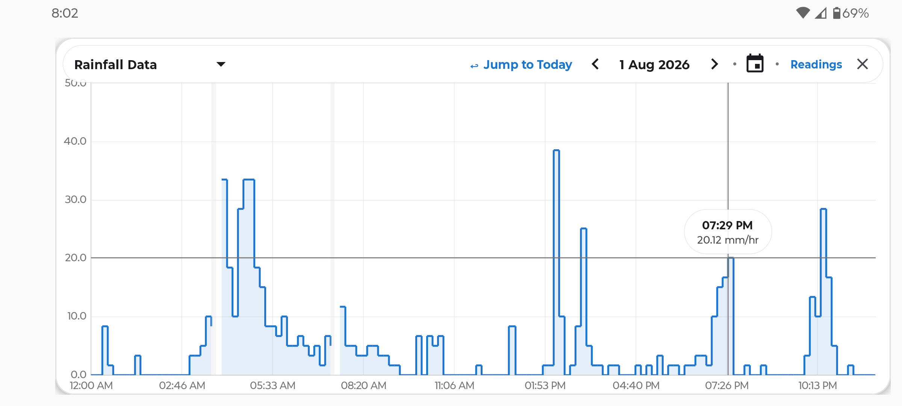</td>
    <td align="center">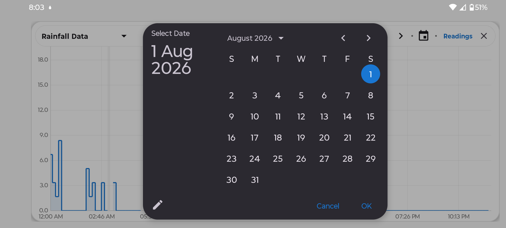</td>
  </tr>
  <tr>
    <td align="center"><em>Tooltip showing time and value (unit changes with the mode)</em></td>
    <td align="center"><em>Date picker</em></td>
  </tr>
</table>

When a date has no data, the chart area shows:

| Mode | Message |
|------|---------|
| Rainfall Data | No Rainfall Data available |
| Temperature Data | No Temperature Data available |
| Pressure Data | No Pressure Data available |
| Humidity Data | No Humidity Data available |

<table>
  <tr>
    <td align="center">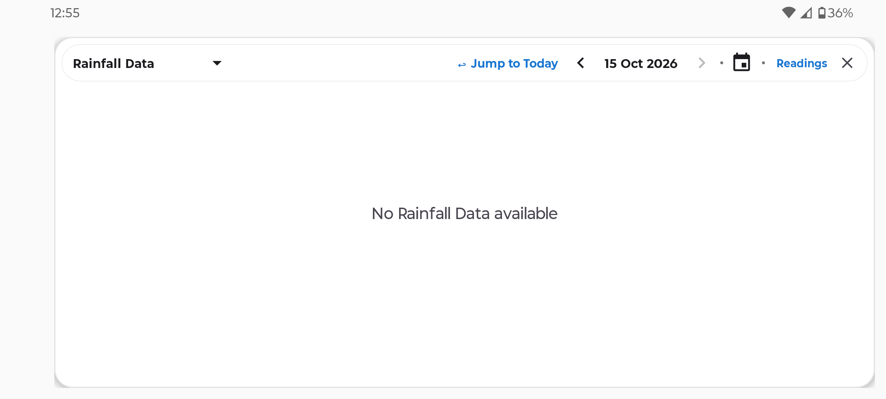</td>
  </tr>
  <tr>
    <td align="center"><em>Empty date in Graph View (shown here in Rainfall Data mode)</em></td>
  </tr>
</table>

### Full-Screen Table

The table lists readings newest-first with intensity-tinted rows.

<table>
  <tr>
    <td align="center">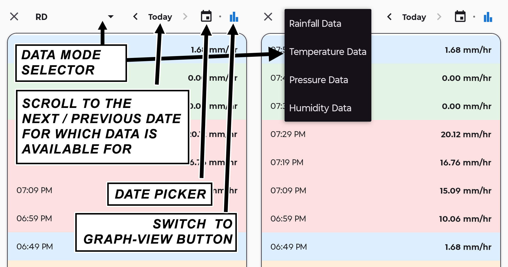</td>
  </tr>
  <tr>
    <td align="center"><em>Table controls: data-mode selector, previous/next available date, date picker, and switch to Graph View</em></td>
  </tr>
</table>

<table>
  <tr>
    <td align="center">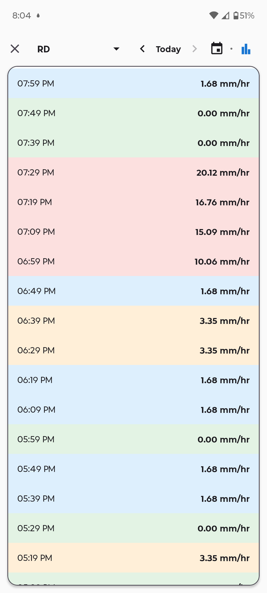</td>
    <td align="center">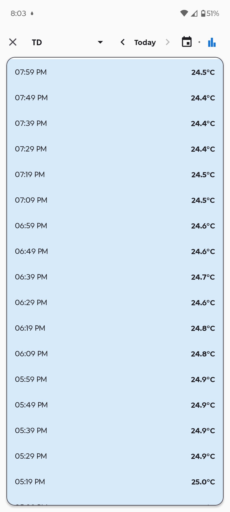</td>
    <td align="center">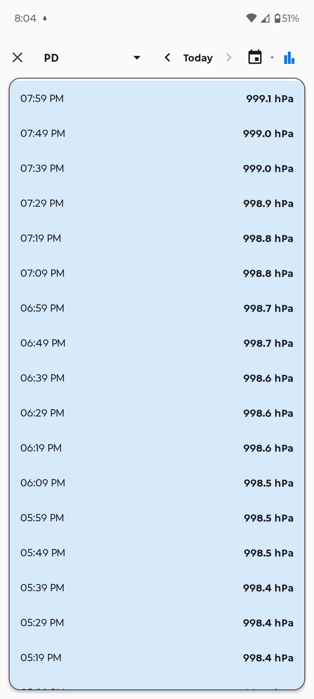</td>
    <td align="center">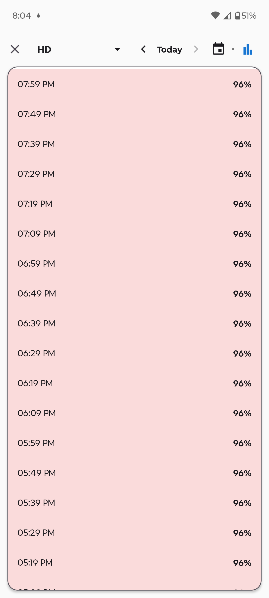</td>
  </tr>
  <tr>
    <td align="center"><em>Rainfall</em></td>
    <td align="center"><em>Temperature</em></td>
    <td align="center"><em>Pressure</em></td>
    <td align="center"><em>Humidity</em></td>
  </tr>
</table>

Long-pressing a row (or a status meter on the dashboard) shows the row's intensity label in a toast — see [Intensity Labels](#intensity-labels).

<table>
  <tr>
    <td align="center"><video src="https://github.com/user-attachments/assets/07435677-cad8-415e-af1d-b36e8e86a3f5" width="240" controls></video></td>
  </tr>
  <tr>
    <td align="center"><em>Long-pressing coloured rows in Table View to reveal intensity labels (Rainfall Data mode) (<a href="assets/videos/table/label.mp4">View original source file</a>)</em></td>
  </tr>
</table>

Dates with no readings show **"No readings for this date"** in every mode.

<table>
  <tr>
    <td align="center">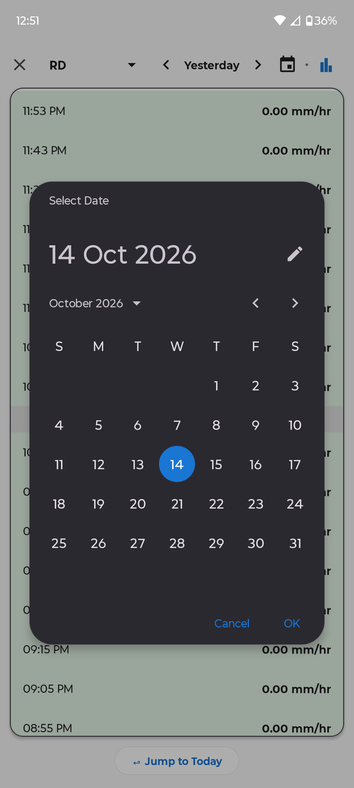</td>
    <td align="center">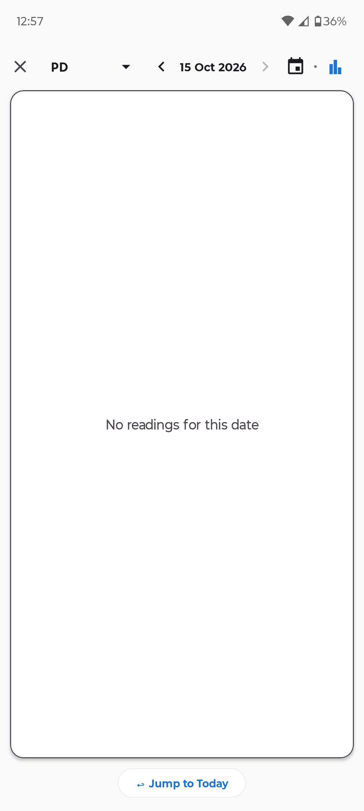</td>
  </tr>
  <tr>
    <td align="center"><em>Date picker</em></td>
    <td align="center"><em>Empty date in Table View (same message in all modes)</em></td>
  </tr>
</table>

### Gap Representation

Every reading is expected 10 minutes apart. If the ESP32 goes silent for longer than the gap threshold — a power cut, for example — the app draws a break instead of a straight line so the outage is never mistaken for real data.

<table>
  <tr>
    <td align="center">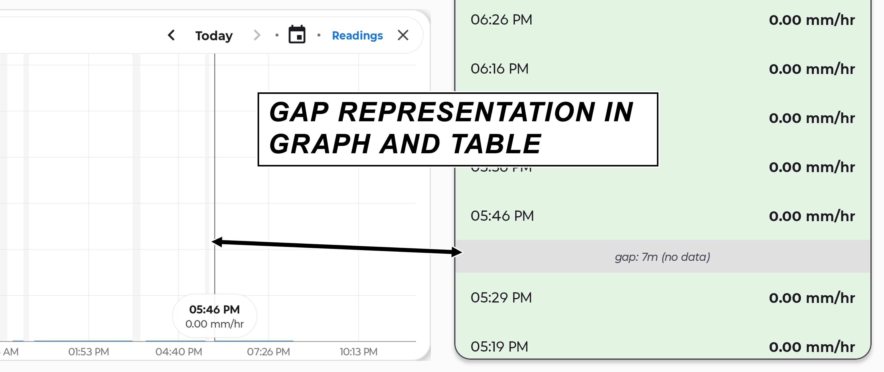</td>
  </tr>
  <tr>
    <td align="center"><em>The same outage rendered as a separator row in Table View and a grey region in Graph View</em></td>
  </tr>
</table>

### Notifications

Rain is announced immediately on the high-priority **alert** channel. The same event is also pushed by the firmware to a private Telegram group for redundancy.

<table>
  <tr>
    <td align="center">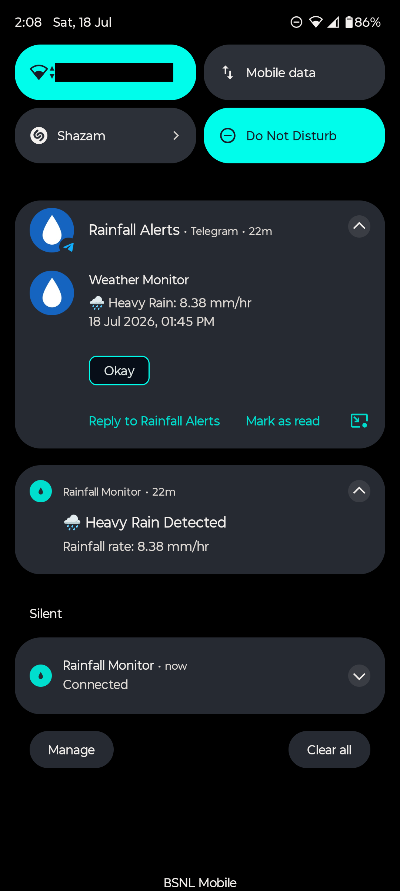</td>
  </tr>
  <tr>
    <td align="center"><em>App rain alert alongside the matching Telegram alert</em></td>
  </tr>
</table>

A permanent, silent notification reports the MQTT connection state. It transitions through **Connecting…**, **Connected**, and **Connection lost — reconnecting…** as the network changes, and re-posts itself if swiped away.

<table>
  <tr>
    <td align="center"><video src="https://github.com/user-attachments/assets/02c2aa2d-75f1-4077-b514-5745b70f2544" width="240" controls></video></td>
  </tr>
  <tr>
    <td align="center"><em>Persistent notification reflecting connectivity changes (<a href="assets/videos/notifications/offline_and_reconnection_notifications.mp4">View original source file</a>)</em></td>
  </tr>
</table>

The app also reconnects instantly once the network returns; readings that were queued by the broker's persistent session arrive right after. The video below opens on the dashboard in the stale `(stale)` / `[S]` state described in [Dashboard](#dashboard), then shows it clearing on reconnection, followed by long-press labels on the dashboard meters.

<table>
  <tr>
    <td align="center"><video src="https://github.com/user-attachments/assets/0deaad39-ab19-490e-b983-85f56475526e" width="240" controls></video></td>
  </tr>
  <tr>
    <td align="center"><em>Stale <code>(stale)</code> / <code>[S]</code> dashboard state clearing after reconnection, queued readings arriving, and long-press intensity labels (<a href="assets/videos/main/reconnect_and_label.mp4">View original source file</a>)</em></td>
  </tr>
</table>

---

## Intensity Labels

Each mode maps its value onto a colour and a human-readable label. The same ranges are used everywhere: dashboard colours, table row tints, and long-press toasts.

**Rainfall** (`mm/hr`)

| Range | Label | Colour |
|-------|-------|--------|
| `rate <= 0` | No Rain | Green |
| `0 < rate <= 2.5` | Light Rain | Blue |
| `2.5 < rate <= 7.5` | Moderate Rain | Orange |
| `7.5 < rate <= 50` | Heavy Rain | Red |
| `rate > 50` | Violent Rain | Purple |

**Temperature** (`°C`)

| Range | Label |
|-------|-------|
| `<= 15` | Cool |
| `<= 25` | Mild |
| `<= 35` | Warm |
| `<= 40` | Hot |
| `> 40` | Extreme |

**Pressure** (`hPa`)

| Range | Label |
|-------|-------|
| `< 1000` | Low |
| `< 1013` | Below Normal |
| `< 1025` | Normal |
| `< 1040` | High |
| `>= 1040` | Very High |

**Humidity** (`%`)

| Range | Label |
|-------|-------|
| `<= 30` | Dry |
| `<= 50` | Comfortable |
| `<= 70` | Humid |
| `<= 85` | Very Humid |
| `> 85` | Extreme |

---

## Architecture

```
ESP32 (MQTT publish, TLS 8883)
        │
        ▼
HiveMQ Cloud Broker ── persistent session, QoS 1
        │
        ▼
MqttService  (foreground, connectedDevice type)
   │  parse JSON → RainfallRepository (StateFlow) + Room DB
   │  staleness / gap / transition detection → notifications
   ▼
MainViewModel / GraphViewModel / ReadingsViewModel
        │
        ▼
MainActivity · GraphActivity · ReadingsActivity
```

The design separates a single long-lived **foreground service** from stateless **UI screens**:

- **`MqttService`** owns the broker connection, parses each payload, writes to the database, updates the repository, and posts notifications. It reconnects using three layers: exponential backoff with jitter, a `ConnectivityManager` network callback for instant reconnect, and MQTT keepalive pings to catch silent TCP deaths.
- **`RainfallRepository`** is a singleton "bulletin board" holding `StateFlow`s of the current live state. The service writes; ViewModels read. This is what makes the dashboard reactive without manual refresh.
- **Room** stores one row per reading (keyed by the ESP32's own NTP timestamp), giving durable history and gap reconstruction.
- **`MqttService`** also persists consecutive-`null` counters and acknowledge flags in `SharedPreferences`, so failure handling survives process restarts.

### Reliability measures

- Foreground service uses the `connectedDevice` type to avoid Android 15's 6-hour `dataSync` timeout.
- `BootReceiver` starts the service on boot (including fast-boot and locked-boot broadcasts).
- `ServiceWatchdogReceiver` fires every ~15 minutes and restarts the service if it died.
- `NotificationDismissReceiver` immediately re-posts the persistent notification if the user swipes it away.
- Stale messages (older than 15 minutes) never alter failure counters — only fresh data does — preventing false alarms after an outage.

---

## Tech Stack

| Area | Choice |
|------|--------|
| Language | Kotlin |
| Min / Target SDK | 26 (Android 8.0) / 35 (Android 15) |
| UI | Single-activity, View Binding, Material Components |
| Architecture | Repository pattern, ViewModel + `StateFlow` |
| Database | Room 2.7.1 |
| MQTT | HiveMQ MQTT Client 1.3.7 (MQTT 5, persistent session, QoS 1) |
| Charting | MPAndroidChart v3.1.0 |
| Async | Kotlin Coroutines |
| Build | Gradle (Kotlin DSL), Java 17 |

---

## Project Structure

```
app/src/main/java/com/sreer/rainfallmonitor/
├── AppConstants.kt                 Staleness threshold shared app-wide
├── MainActivity.kt                 Single-screen dashboard
├── RainfallApp.kt                  Application class, notification channels
├── data/
│   ├── AppDatabase.kt              Room database singleton
│   ├── dao/RainfallReadingDao.kt   Queries (day ranges, distinct dates, latest)
│   └── entity/RainfallReading.kt   Reading row (rate, T/P/H, timestamp, datestamp)
├── mqtt/MqttService.kt             Foreground MQTT service, notifications, watchdog
├── notification/NotificationHelper.kt  Rain / offline / sensor-failure builders
├── receiver/
│   ├── BootReceiver.kt             Starts service after boot
│   ├── ServiceWatchdogReceiver.kt  Restarts service if it died
│   └── NotificationDismissReceiver.kt  Re-posts persistent notification
├── repository/
│   ├── ConnectionState.kt          CONNECTED / CONNECTING / OFFLINE
│   └── RainfallRepository.kt       Live StateFlow "bulletin board"
└── ui/
    ├── BaseDateNavigationViewModel.kt  Shared date stepping logic
    ├── BlinkingUtils.kt            Warning-icon blink animation
    ├── MainViewModel.kt            Dashboard state + intensity helpers
    ├── SensorMode.kt               RAINFALL / TEMPERATURE / PRESSURE / HUMIDITY
    ├── graph/                      GraphActivity, GraphFragment, ChartMarkerView,
    │                               GraphDataBuilder, GraphViewModel
    └── table/                      ReadingsActivity, ReadingsAdapter,
                                    ReadingsViewModel
```

---

## Building

**Requirements:** Android Studio (Ladybug or newer) or the Gradle CLI, JDK 17, and an Android device/emulator running API 26+.

```bash
# Debug build
./gradlew assembleDebug

# Install on a connected device
adb install -r app/build/outputs/apk/debug/app-debug.apk
```

The first launch requests notification permission (Android 13+) and asks to exclude the app from battery optimisation — both are needed for 24/7 monitoring.

---

## Configuration

MQTT credentials are **not committed**. They are read from `local.properties` (git-ignored) and injected into `BuildConfig` at compile time:

```properties
mqtt.broker.host=your-hivemq-host
mqtt.broker.port=8883
mqtt.username=your-username
mqtt.password=your-password
mqtt.topic.status=rainfall/status
```

The expected payload on `rainfall/status`:

```json
{
  "rate": 1.68,
  "pressure": 997.78,
  "temperature": 26.03,
  "humidity": 94.20,
  "timestamp": 1785344133000
}
```

`timestamp` is the ESP32's NTP time in milliseconds and is treated as the source of truth — the phone clock is never used to place a reading.

---

## Permissions

| Permission | Why |
|------------|-----|
| `INTERNET`, `ACCESS_NETWORK_STATE`, `CHANGE_NETWORK_STATE` | MQTT connection and connectivity monitoring |
| `FOREGROUND_SERVICE`, `FOREGROUND_SERVICE_CONNECTED_DEVICE` | Keep the MQTT service alive indefinitely |
| `POST_NOTIFICATIONS` | Rain, offline, and failure alerts |
| `RECEIVE_BOOT_COMPLETED` | Restart monitoring after reboot |
| `SCHEDULE_EXACT_ALARM` | Watchdog that restarts the service |
| `REQUEST_IGNORE_BATTERY_OPTIMIZATIONS` | Prevent the OEM from killing the service |

---

## Reliability

The app is built to run unattended on a Motorola Moto G64 with minimal battery restrictions.

- **Three-layer reconnection** keeps the MQTT link up across Wi-Fi drops, sleep, and network switches.
- **Persistent session (24 h expiry)** means messages produced while offline are delivered on reconnect.
- **Staleness handling** greys out and flags data older than 15 minutes, and raises the ESP32-offline alert.
- **Sensor failure** is declared only after two consecutive fresh `null` readings, announced once per episode, and can be silenced with the **Acknowledge** action while the failure continues.
- **Gap reconstruction** distinguishes genuine ESP32 outages from ordinary 10-minute spacing, both in the table and on the graph.

---

## License

This project is licensed under the MIT License. The full license text is provided in the [LICENSE](LICENSE) file in this repository.
